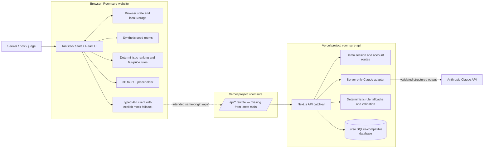

# Roomsure technical architecture

**Status:** current hackathon MVP architecture  
**Last reviewed:** 2026-11-08  
**Related:** [README](README.md) · [Solution design](SOLUTION_DESIGN.md) · [MVP requirements](Roomsure%20MVP%20Requirements%20%28for%20LLM%20build%29.md) · [Demo script](demo-script.md)

This document describes the latest `main` source as inspected on 2026-11-08. The product has two deployable apps: `website/` is the browser experience and `platform/` is the API. The browser client calls same-origin `/api/*` paths. **The latest `main` branch no longer contains `website/vercel.json`, so the production proxy is not configured in source right now.** The previous live routing check predates that removal; restore and verify the rewrite before claiming the frontend is reaching the backend.

## 1. System diagram

**Browser requests:** `website/src/lib/roomsure/api.ts` is the screen-facing API. `backend.ts` handles JSON requests and response mapping. `withFallback()` uses local mocks only when the backend is unavailable or explicitly disabled. A JSON error from a reachable backend is surfaced rather than hidden by a mock.

**Production routing:** The required rewrite is `/api/:path*` → `https://roomsure-api.vercel.app/api/:path*`. It existed in an earlier branch but was removed from the latest `main`; add it back to `website/vercel.json` and deploy before expecting frontend Claude/session requests to reach the API. Without a proxy, the browser's API client falls back locally on an HTML/non-JSON response. When restored, the rewrite keeps session cookies on the website origin from the browser's perspective. Backend `APP_URL` must exactly match the public frontend origin because POST routes enforce an origin check.

## 2. Deployable apps

| App | Source | Framework | Vercel settings | Responsibility |
|---|---|---|---|---|
| Website | `website/` | TanStack Start, React, Vite, TypeScript | Project `roomsure`, root directory `website/` | Screens, browser session state, local demo inventory, matching, swipe/match UI and RoomWalk viewer. |
| API | `platform/` | Next.js App Router, TypeScript, Node runtime | Project `roomsure-api`, root directory `platform/` | Claude requests, origin checks, demo session/account routes, simulated reservation state and database adapter. |

The projects are connected to GitHub and deploy when their tracked branch changes. Preview and production environment variables are managed separately in Vercel. `ANTHROPIC_API_KEY` is set only in the API project; never use a `NEXT_PUBLIC_` prefix for secrets.

## 3. Request flows

### Natural-language intake

1. `StartScreen` sends the user's sentence to `api.parseIntake()`.
2. The browser calls `POST /api/intake` with `{ "text": "..." }`.
3. The backend validates the request, applies a rate limit, and calls `readIntake()`.
4. The Claude adapter requests structured output, validates it with Zod, drops invalid values and protected-trait content, and converts it to typed preferences.
5. If the key is absent or the call times out, is refused, or returns invalid output, deterministic intake rules run. The response includes `source` and a fallback marker; the UI labels Claude vs rules.
6. The user can edit extracted preferences. `buildDeck()` reranks locally; changing priorities does not make a network request.

### Scam check

1. `CheckScreen` sends pasted text to `POST /api/check`.
2. Code always runs its deterministic signals and fair-price estimate.
3. Claude may suggest additional signals with exact evidence. The backend only accepts known signal IDs and quotes that appear verbatim in the submitted text.
4. Code computes the final verdict. Claude does not decide whether a listing is safe, and the product does not certify outside listings.

### Demo account and simulated reservation

1. The frontend calls `GET /api/me`; when there is no session it calls `POST /api/demo/login` and retries `GET /api/me`.
2. The backend issues an HTTP-only session cookie and stores demo account/session/payment state in the configured database.
3. Demo host replies and matches are UI simulations. A reservation flow uses server-side room IDs/prices and simulated completion; it does not move money.
4. `POST /api/demo/reset` clears the demo reservation/activity state for the current session.

### Host listing (current boundary)

The latest `main` branch does not include a host listing workflow. There are no host-listing API routes or persistent host listing tables. Do not describe host listings as available, shared, persisted, or Claude-extracted.

## 4. Data ownership

| Data | Current source / storage | Persistent across devices? |
|---|---|---|
| Seeker demo inventory and listing details | Synthetic TypeScript seed data in `website/src/lib/roomsure/data/listings.ts` | Yes as code; not live inventory. |
| Ranking preferences, swipes, match state | Client state and browser localStorage | No; browser/device scoped. |
| Host profile, draft and published room | Browser localStorage | No; local demo only. |
| Demo users, sessions, payment/activity records | `platform/lib/db.ts`; Turso in hosted setup, SQLite for local development | Yes while Turso is configured; demo data only. |
| Claude API key | Vercel environment variable on `roomsure-api` | Secret; server execution only. |
| RoomWalk tour UI | `TourOverlay` component | The latest `main` removed `website/public/scans`; tour currently renders a placeholder. |

Current Turso configuration: `TURSO_DATABASE_URL`, `TURSO_AUTH_TOKEN`, and `TURSO_REQUIRED=true`. Local SQLite is the development fallback. Do not use ephemeral Vercel filesystem storage as a production database.

## 5. API surface

The implementation uses `platform/app/api/[...path]/route.ts` as its API router. Every request runs the explicit provider-mode guard and initializes the demo account/schema. POST routes except the Stripe webhook require an `Origin` equal to `APP_URL`.

| Method and path | Auth | Purpose |
|---|---|---|
| `GET /api/me` | Optional | Returns current demo-safe user snapshot, mode, payment and recent activity. |
| `POST /api/demo/login` | None | Creates the demo seeker session. Demo mode only. |
| `POST /api/demo/reset` | Session | Clears simulated payment/activity state. |
| `POST /api/intake` | None | Text to typed preferences via Claude or rules. |
| `POST /api/check` | None | Listing text to facts, quoted signals and code-computed verdict. |
| `POST /api/payment/start` | Session / eligibility rules | Begins a provider or demo payment at a server-derived amount. |
| `POST /api/demo/complete` | Session | Demo-only simulated payment/identity completion. |
| `POST /api/auth/signup`, `/api/auth/login`, `/api/auth/logout` | Varies | Account/session flows. |
| `POST /api/email/send`, `/api/email/verify`, `/api/identity/start`, `/api/card/start` | Session | Demo/provider-backed onboarding routes; demo outcomes are simulated. |
| `POST /api/host/consent`, `/api/security/password` | Session | Host self-attestation and password change. |
| `POST /api/webhook` | Stripe signature | Provider webhook when a test provider is deliberately configured. |

Avoid adding routes for UI-only features. If host listings become a team milestone, define listing ownership, validation, visibility, duplicate publish behavior, edit/delete semantics, and image storage before implementation.

## 6. Ranking and trust rules

- Active website ranking code is in `website/src/lib/roomsure/rankListings.ts` and `deck.ts`; tests live next to it in `website/src/lib/roomsure/`.
- The ranking engine is deterministic TypeScript. AI never chooses a room score or the final scam verdict.
- Synthetic listing prices, fair-price baselines and commute estimates must be labeled as demo estimates. Do not present them as verified market data.
- Trust labels and identity/payment outcomes in the demo are simulations. A simulated badge is not real-world verification.
- Matching must not use protected traits. Treat listing text and AI output as untrusted; validate every server boundary.

## 7. AI service boundaries

- Adapter: `platform/lib/ai/claude.ts`; schemas: `platform/lib/ai/schemas.ts`.
- SDK client is created only on the server. `ANTHROPIC_API_KEY` and optional `ANTHROPIC_MODEL` are read from the API environment.
- The current adapter uses `claude-opus-5-5` by default, structured output, low effort, and an 8-second timeout.
- AI is optional. On missing key, timeout, refusal, connection/API error, or invalid schema, the routes return a deterministic rules result with a source label.
- Do not log API keys, expose raw prompts/responses to browsers, or add a client-side Anthropic SDK.
- Live calls spend Anthropic credits. Unit/E2E tests use fakes or empty keys; the paid evaluation harness must only be run with explicit team approval.

## 8. Environment and deployment configuration

### `roomsure-api`

| Variable | Required | Purpose |
|---|---:|---|
| `APP_URL` | Yes | Exact public frontend origin, e.g. `https://roomsure-hackathon.vercel.app`. |
| `PROVIDER_MODE=demo` | Yes | Keeps payment/verification outcomes simulated. |
| `TURSO_DATABASE_URL` | Hosted | Turso database URL. |
| `TURSO_AUTH_TOKEN` | Hosted | Secret Turso token. |
| `TURSO_REQUIRED=true` | Hosted | Prevents silent use of local SQLite if Turso is missing. |
| `ANTHROPIC_API_KEY` | Optional | Secret Claude API credential; server-side only. |
| `ANTHROPIC_MODEL` | Optional | Model override; otherwise adapter default. |

### `roomsure`

- `website/vercel.json` should own the production API rewrite, but is missing from latest `main`. Restore it and verify `https://roomsure-hackathon.vercel.app/api/me` before the demo.
- Browser build must not contain Claude, Turso, Stripe, or Resend secrets.
- For preview environments, verify the preview frontend/backend URL and the API's `APP_URL`/origin policy before expecting POST requests to pass.

### Local development

- Backend: from `platform/`, set `APP_URL=http://localhost:5173` and run `npm run dev` on port 3000.
- Website: from `website/`, run `npm run dev -- --port 5173`; Vite proxies `/api` to port 3000.
- Backend requires Node 24+ for the built-in SQLite driver.

## 9. Validation and evaluation

- Backend unit tests: `cd platform && npm test`.
- Backend browser tests: `cd platform && npm run test:e2e` (install Chromium first).
- Website unit/component tests: `cd website && npm test`.
- Type-check/build: `cd platform && npm run typecheck && npm run build`; `cd website && npm run build`.
- Ranking reference: `cd platform && npx tsx --test ../ranking/rankListings.test.ts`.
- AI quality evaluation: fixed cases and plain-code graders in `platform/evals/`. It makes real Anthropic calls; never run it automatically as part of a demo or CI build.
- End-to-end smoke check: open production website; submit the demo intake and verify the source badge; change ranking weights; submit the scam sample and verify quoted evidence; open a sample 3D tour; exercise mock match/reservation; confirm the simulated label.

## 10. Known limitations and next work

1. Host listing CRUD/persistence and image upload are not implemented; listings created by hosts remain browser-local.
2. Inventory, room prices, fair-price baselines and commute estimates are synthetic, not live or audited market data.
3. ID/card/email checks, host replies, chat and payment in the presented demo are simulated. No escrow or deposit protection exists.
4. Swipes and preferences are browser-local and do not train or personalize a model across users.
5. The latest `main` does not bundle scan assets; the 3D tour view is a placeholder. Don't plan it as a working demo moment until sample assets are restored and smoke-tested.
6. Before real users: add real identity/payment provider configuration, legal/privacy/data-retention review, robust shared rate limiting, support and dispute handling, security monitoring, and trustworthy listing/host inventory.
