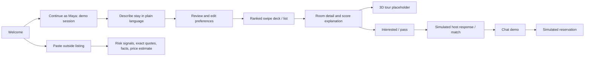
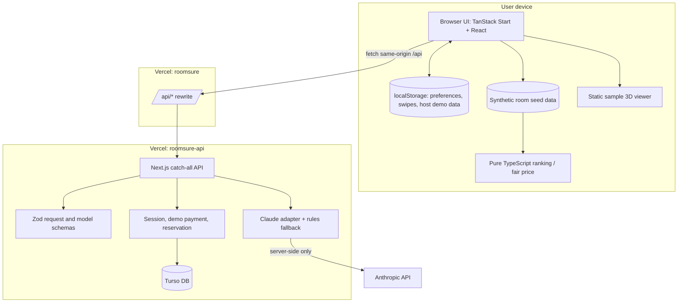

# Roomsure solution design

**Version:** hackathon MVP  
**Reviewed:** 2026-11-08  
**Status:** working demo, not production rental infrastructure

This design describes the solution we can demonstrate now and draws a clear line around what is simulated. It complements [the product requirements](Roomsure%20MVP%20Requirements%20%28for%20LLM%20build%29.md) and [technical architecture](ARCHITECTURE.md).

## 1. Product goal

Help a person looking for a one-to-six-month room make a more informed choice by turning their needs into editable criteria, showing explainable room trade-offs, and pointing out evidence in suspicious outside listings.

### User problem

Short-term renters are forced to compare nightly-stay options, long leases, and unstructured sublet posts. Those options make it difficult to compare price, dates, commute, fit, and trust in one place.

### Primary demo user

Maya is an intern coming to Providence. She needs a furnished room, has a target and maximum budget, cares about commute time, and is willing to accept a small date gap. Her scenario is synthetic and exists to make the workflow concrete.

### Design principles

1. **Show the trade-off:** every ranked result should make clear why it appears where it does.
2. **Keep choices editable:** AI proposes preferences; the seeker reviews and changes them.
3. **Keep decisions deterministic:** normal code computes ranking, fair-price labels, and scam verdicts.
4. **Show evidence:** scam warnings quote text the user pasted; vague labels alone are not enough.
5. **Name demo boundaries:** simulated identity, trust, chat, match, and payment states must be labeled.
6. **Minimize sensitive data:** demo does not request real identity documents or payment card details.

## 2. Scope and actors

| Actor | Current MVP capability |
|---|---|
| Seeker / judge | Demo login, describe needs, edit preferences, swipe/list ranked synthetic rooms, view score explanation, inspect matches/chat demo, run a scam check, simulate a reservation. The current 3D tour screen is a placeholder. |
| Host / judge | Host listing workflow is not present in the latest `main` branch; inspect before promising it in the demo. |
| Roomsure system | Extract user needs with Claude or rules, rank rooms deterministically, check pasted listings, store demo session/reservation state on the backend. |
| External listing source | Paste-only, untrusted text. Roomsure does not fetch or verify the source. |

### In scope for the demo

- Providence-focused, synthetic seed inventory and commute estimates.
- Natural-language intake with visible `Claude` / `rules` source labels.
- Editable budget, commute, dates, facilities, destination, and priority settings.
- Instant client-side ranking and near-miss explanations.
- Outside listing analysis with exact quoted warning evidence and code-computed verdict.
- A room detail tour entry point; the latest `main` branch has no bundled scan assets, so the tour currently shows a placeholder.
- Match, chat, host verification, and reservation interactions clearly marked simulated.

### Out of scope for the demo

- Live inventory search, Google Maps/transit API, background verification, identity/document capture, actual $1 card authorization, escrow, deposits, payouts, live messaging, moderation operations, or a legally meaningful safety guarantee.
- Host listing workflow; the latest `main` branch does not include it.
- Training on swipe behavior or automatically making housing decisions from protected personal traits.

## 3. Information architecture and primary workflows

### Seeker journey



### Host listing

The latest `main` branch removed the host listing screen and related assets. Do not include host listing extraction/publishing in the current demo or present it as a working capability.

## 4. Detailed behavior

### Intake and preference review

**Input:** one sentence or short paragraph. Example:

> I'm interning downtown June 1 to August 15. Budget around $900, $1,050 max. Commute ideally 20 minutes, 35 at most. I need a kitchen, furnished matters a lot, and I can live with up to 5 days' gap.

**System behavior:**

- `POST /api/intake` validates text length and rate limit.
- Claude may return typed preference data using a Zod schema. The backend validates and normalizes values; it excludes protected-trait fields.
- A deterministic parser handles no-key, timeout, refusal, or invalid-response cases.
- The UI visibly labels which parser answered. All values are editable before the user opens results.
- Missing key info may be requested as a follow-up; the UI currently exposes follow-up questions during intake.

**Acceptance:** the sample request can be parsed by Claude or the rules fallback, with source disclosed; changing any preference does not require a server request for ranking.

### Ranking, swipe, and details

- The active engine is TypeScript in `website/src/lib/roomsure/rankListings.ts` and wrapper `deck.ts`.
- It filters impossible rooms, scores fit against the explicit preference/priority weights, and returns ranked cards and near misses.
- Every score is deterministic and should be explainable in terms of the user's criteria. No Claude score is accepted.
- Swipe history removes cards from the active deck while preserving rank information. Undo is supported.
- Data comes from `website/src/lib/roomsure/data/listings.ts`; it is curated synthetic seed content.
- A detail page includes the same score/explanation and a 3D tour entry point. No scan assets are bundled on latest `main`, so the current tour is a placeholder.

### Scam check

**Input:** pasted text from a listing, not an external URL fetch.

**Output:** parsed facts where possible, deterministic fair-price estimate where supported, risk verdict, and named signals with exact quotes.

Claude can suggest signal IDs/quotes, but the backend rejects unknown IDs or non-verbatim quotes and code computes the verdict. The output should be framed as warning signals, not a conclusion that a person is a scammer or a listing is safe.

### Host listing

The host can complete the local form and publish a listing into browser storage. The UI marks it as a demo listing and tells the user it is visible only in the current browser. No backend persistence, AI extraction, or cross-device listing visibility is implemented. This is a follow-on engineering item, not a completed MVP capability.

### Match, chat, and reservation

- Host replies are time-delayed deterministic demo outcomes.
- A mutual match and chat are simulated; chat messages are canned UI content, not real delivery.
- Reservation records use a server-derived listing ID and amount and are stored through the demo backend/database path.
- Completion is simulated; there is no card charge, escrow, or protection of a real deposit.

## 5. Solution architecture



### Technology choices

| Layer | Technology | Reason for this MVP |
|---|---|---|
| UI | TanStack Start, React, TypeScript, Vite, Tailwind | Existing Lovable export, screen/component architecture and tests. |
| API | Next.js App Router, TypeScript, Node runtime | Existing route/session/validation implementation and Vercel deployment. |
| Validation | Zod | Validate user input, AI structured output, and API payloads. |
| AI | Anthropic TypeScript SDK, server-side | Natural-language intake and listing signal suggestions, with visible fallback. |
| Database | Turso (hosted SQLite-compatible) plus local SQLite development path | Persistent demo accounts/session/payment state on serverless deployment. |
| Listing data | TypeScript seed data | Small curated demo inventory; no database or live listing API needed for the presentation. |
| Hosting | Two Vercel projects from one GitHub repository | Allows front-end and backend changes to deploy independently with the same-origin API rewrite. |
| 3D | RoomWalk static viewer and bundled sample assets | Shows the inspection concept without a GPU service in the live presentation. |

## 6. API and data contracts

| Endpoint | Request | Response summary | Current use |
|---|---|---|---|
| `GET /api/me` | Session cookie optional | Demo mode, safe user snapshot, payment/activity snapshot | Connectivity check and demo session. |
| `POST /api/demo/login` | `{}` | Success plus session cookie | Continue as demo user. |
| `POST /api/intake` | `{ text: string }` | Preferences, destination, missing fields, questions, source, fallback | Claude or rules intake. |
| `POST /api/check` | `{ text: string }` | Verdict, signals/evidence, listing facts, fair-price estimate, source | Claude-assisted signal proposals + rules. |
| `POST /api/payment/start` | `{ listingId: string }` | Provider/demo checkout result | Demo reserve flow; amount resolved server-side. |
| `POST /api/demo/complete` | `{ kind, outcome, listingId? }` | Completion state | Demo-only payment/verification simulation. |
| `POST /api/demo/reset` | `{}` | Success | Clear simulated reservation/activity for rehearsal. |

Other identity, email, host-consent and password routes are present in `platform/`. Full route details and provider mode are documented in `platform/README.md` and `ARCHITECTURE.md`.

## 7. Security, privacy, and fairness

- Secrets (Anthropic, Turso, Stripe, Resend) stay on the server. The browser never receives them.
- All non-webhook JSON POSTs validate the request origin against `APP_URL`.
- Use Zod at API/model boundaries and rate-limit public AI routes.
- Do not log sensitive user text or API credentials unnecessarily.
- Do not ask for or use protected traits for matching, ranking, or screening.
- Demo data must be labeled synthetic. Do not encourage users to enter real identity or card information.
- Quote-check AI output against original text. Don't present AI as a guarantor or authoritative housing/legal/financial decision maker.
- Keep demo/Stripe provider mode explicit; the default presentation must not move real money.

## 8. Test and evaluation approach

### Automated checks

- Frontend tests for API mapping/fallback, ranking, state, and important components.
- Backend unit tests for Claude parsing/fallback, rule signals, server-side amount selection, auth/origin controls, and database behavior.
- Backend Playwright tests for demo paths and browser behavior.
- Type checks and production builds for both apps.
- Fixed AI accuracy cases with a plain-code grader in `platform/evals/`. Running the live AI evaluation incurs API cost and must be approved separately.

### Manual acceptance checks

1. Open the public frontend and confirm it renders without Vercel team login.
2. Submit intake and verify the source badge is either `Read by Claude` or `Read by rules (offline)`.
3. Open the room deck; change a priority and verify order/reason updates immediately.
4. Swipe/open a card; skip the 3D tour placeholder unless scan assets have been restored and verified.
5. Paste the high-risk sample; verify exact quoted phrases and warning verdict.
6. Exercise simulated match/reservation and confirm the UI says simulated/no money moves.
7. Confirm the room detail's 3D-tour placeholder is labeled accurately; skip it in the timed demo until assets are restored.

## 9. Operational setup

### Backend Vercel environment

```text
APP_URL=https://roomsure-hackathon.vercel.app
PROVIDER_MODE=demo
TURSO_DATABASE_URL=<secret or URL>
TURSO_AUTH_TOKEN=<secret>
TURSO_REQUIRED=true
ANTHROPIC_API_KEY=<server-only secret>
```

Configure variables in the backend project's **Production** environment; add **Preview** values if preview API deployments should call Anthropic/Turso. Redeploy after changing variables.

### Frontend Vercel configuration

- Root directory is `website/`.
- Ensure the production rewrite in `website/vercel.json` points to the active `roomsure-api` domain.
- Production URL is `https://roomsure-hackathon.vercel.app/`.

## 10. Work sequencing

1. **Current demo stability:** preserve API rewrite, verify live AI source label, rehearse all steps and create desktop/mobile recordings.
2. **Backend listing persistence:** specify and add host listing CRUD routes, ownership checks, validation, image storage plan, and Turso schema; migrate host publish UI to API with offline demo fallback.
3. **Shared listing source:** eliminate duplicate website/backend price fixtures with a typed contract or generated shared package.
4. **Real integrations:** only after trust/legal decisions, integrate identity checks, payment provider/escrow alternatives, real chat, moderation, and support operations.
5. **Production readiness:** privacy/data-retention, threat model, access control, observability, abuse handling, rate limits, backup/recovery, accessibility and load checks.

Do not add host-listing storage, real verification, real payments, or an external search provider just to make the demo appear more complete. Implement only after the intended user outcome and failure path are agreed by the team.
